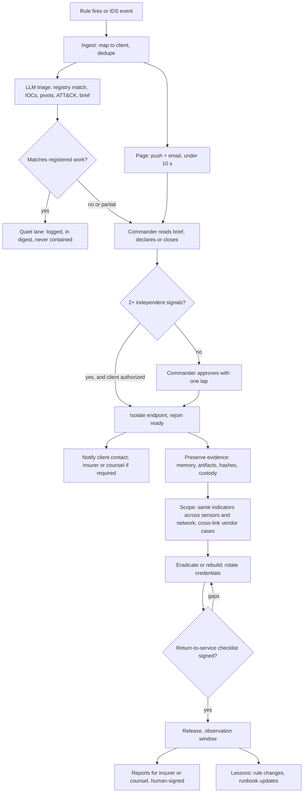

# True Positive Response Sequence

How a confirmed or likely true positive is handled, from detection to lessons learned. Phases follow the standard incident-response lifecycle (detection and analysis, containment, eradication and recovery, post-incident).

## Phases and proposed targets
| Phase | Elapsed | Targets (proposals to tune against real cases) |
|---|---|---|
| 1 Detect | 0 to 1 min | page delivered under 10 s |
| 2 Triage | 1 to 15 min | acknowledged within 5 min for high/critical (re-page every 10 min); brief in the case under 5 min; incident declared or closed under 15 min |
| 3 Contain | 15 to 60 min | isolation automatic on stacked evidence, else on approval; client told right after |
| 4 Eradicate and recover | hours to days | evidence collected before any wipe; release only with the signed checklist |
| 5 Learn | days to weeks | reports reviewed and signed; rule and runbook changes shipped |

## The four decisions
1. **Ours?** Actor and lineage match registered work. Match: log and stop. Partial or none: continue.
2. **2+ signals?** Independent signals agree, or a clear active-exploitation pattern.
3. **Client authorization.** Isolation of a client endpoint requires prior contractual authorization; otherwise it is always the commander's call after a phone call.
4. **Signed?** Return to service only after the checklist is signed.

## Record keeping
Every tool call, message, approval and action goes to the append-only case log. Evidence has hashes and chain of custody. External reports tag findings observed, inferred or unverified and state limitations. The system never drafts admissions of fault, refunds or insurance offers; those come from the human.
